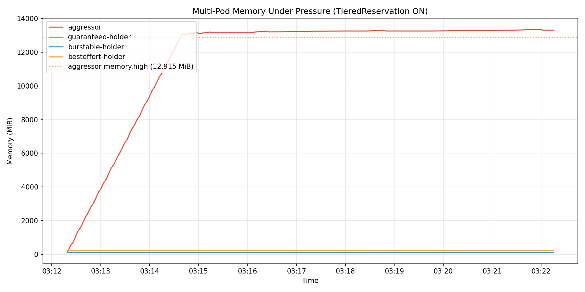
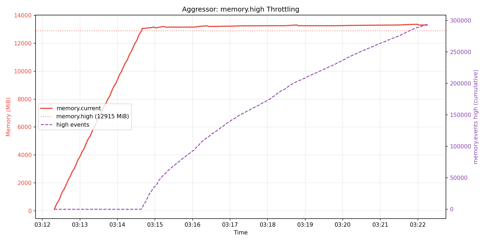
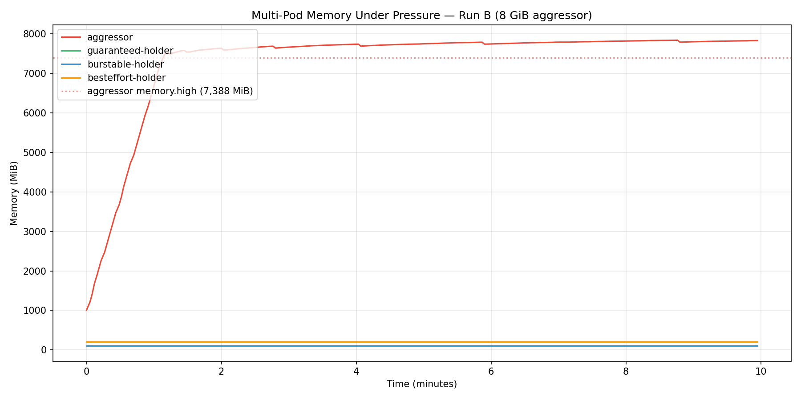
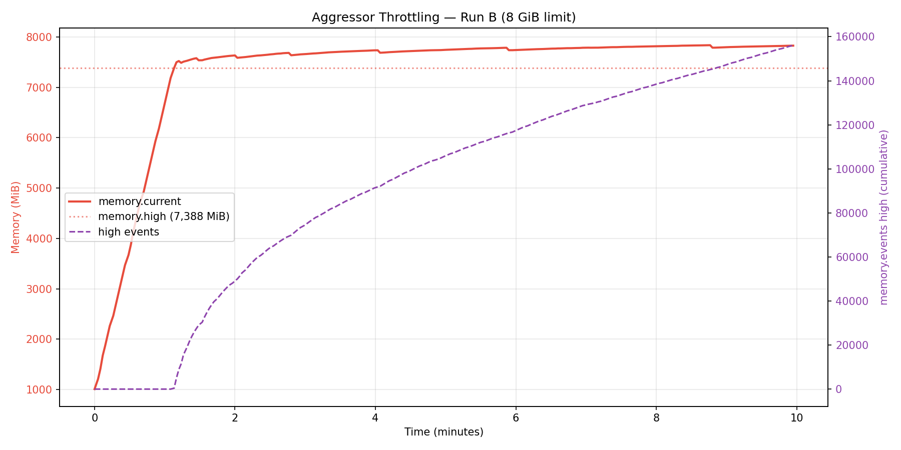
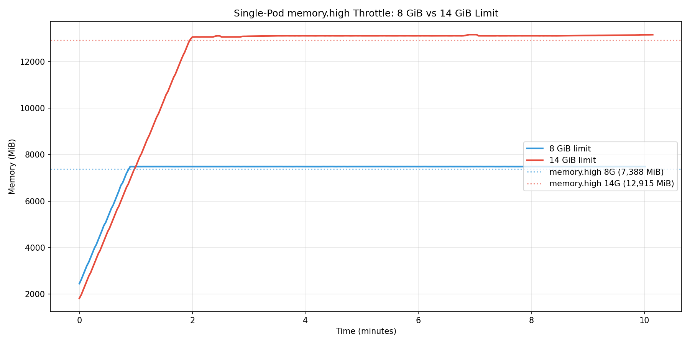

# KEP-2570: MemoryQoS Benchmark Results (Beta)

Beta graduation benchmarks on a build that includes the BestEffort memory.high fix ([kubernetes/kubernetes#138139](https://github.com/kubernetes/kubernetes/pull/138139)), the rollback cleanup PRs ([#138903](https://github.com/kubernetes/kubernetes/pull/138903), [#139377](https://github.com/kubernetes/kubernetes/pull/139377)), and all other MemoryQoS changes merged to master through 2026-06-01.

See [README.md](README.md) for the Alpha benchmark results run on commit [c8468eacac5](https://github.com/sohankunkerkar/kubernetes/commit/c8468eacac5).

---

## Test Environment

| Component | Version |
|-----------|---------|
| Kernel | 7.0.9-205.fc44.x86_64 |
| Kubelet | v1.37.0-alpha.0.1256+dc7be641101f4a-dirty (master, includes [dc7be641](https://github.com/kubernetes/kubernetes/commit/dc7be641101f4ad0ba4d13478e65839b0fa7deb2)) |
| Container Runtime | CRI-O 1.34.3 ,CRI-O 1.37.0 |
| Cluster | local-up-cluster.sh, single node |
| cgroup | v2 |
| Node allocatable memory | 32388480Ki (30.9 GiB) |

Kubelet configuration: `MemoryQoS=true`, `memoryReservationPolicy=TieredReservation`, `memoryThrottlingFactor=0.9` (default).

Data was collected by polling cgroup files every 1s from the container's cgroup path on the node. Collection script: [`scripts/collect-cgroup-data.sh`](scripts/collect-cgroup-data.sh).

---

## 1. memory.high Throttle Behavior

**Pod spec**: [`manifests/throttle-test-pod.yaml`](manifests/throttle-test-pod.yaml) - Burstable pod, requests=256Mi, limits=512Mi.

`memory.high` = floor[(256 + 0.9 * (512 - 256)) / 4096] * 4096 = 486 MiB (510025728 bytes)

| Metric | alpha | beta |
|--------|-------------|-------|
| Time to reach memory.high | ~49s | ~41s |
| Peak memory | 511 MiB | 511 MiB |
| Total `memory.events` high counter | 3,596 | 4,234 |
| Duration to OOM-kill | 71s | 54s |
| Pod exit reason | OOMKilled | OOMKilled |

Behavior is consistent: the container progresses through throttling to OOM-kill. Timing variation is expected across runs (the alpha repeated trials showed 59-65s, ~9% spread).

Raw data: [`data/01-throttle-test-factor-0.9-v2.csv`](data/01-throttle-test-factor-0.9-v2.csv)

---

## 2. Tiered Memory Protection

Guaranteed pods get `memory.min` (hard protection). Burstable pods get `memory.low` (soft protection). BestEffort pods now get `memory.high` set (fixed in [#138139](https://github.com/kubernetes/kubernetes/pull/138139)).

| QoS Class | memory.min | memory.low | memory.high |
|-----------|-----------|-----------|------------|
| Guaranteed (req=lim=256Mi) | 256 MiB | 0 | max |
| Burstable (req=128Mi, lim=256Mi) | 0 | 128 MiB | 243 MiB |
| **BestEffort** | **0** | **0** | **28,556 MiB** |

**BestEffort fix**: In the alpha run, `memory.high` was `max` (no throttling). Now it is correctly set to `floor[(0.9 * node_allocatable) / pageSize] * pageSize` per the KEP formula. This was fixed by [kubernetes/kubernetes#138139](https://github.com/kubernetes/kubernetes/pull/138139) — the code previously treated `request == limit` (both 0) as Guaranteed, skipping memory.high.

### Multi-container pod (Burstable)

| Resource | memory.low | memory.high |
|----------|-----------|------------|
| Container A (req=128Mi, lim=256Mi) | 128 MiB | 243 MiB |
| Container B (req=64Mi, lim=128Mi) | 64 MiB | 121 MiB |
| **Pod total** | **192 MiB** | -- |

### Cgroup hierarchy

| Level | memory.min | memory.low |
|-------|-----------|-----------|
| kubepods.slice | 518 MiB | 0 |
| kubepods-burstable.slice | 0 | 262 MiB |

kubepods root `memory.min` = sum of Guaranteed `memory.min` + Burstable `memory.low`: 256 MiB (guaranteed-test) + 192 MiB (multi-container) + 70 MiB (coredns) = 518 MiB. Burstable QoS `memory.low` = 192 MiB + 70 MiB = 262 MiB. The parent must cover both hard and soft protection for the hierarchy to be effective.

Raw data: [`data/v2-tiered-protection.txt`](data/v2-tiered-protection.txt)

---

## 3. Rollback Safety

Burstable pod (requests=128Mi, limits=256Mi). Disabled MemoryQoS by setting `MemoryQoS: false` and removing `memoryReservationPolicy`, then restarted kubelet.

| Level | Knob | Before | After | Status |
|-------|------|--------|-------|--------|
| kubepods root | memory.min | 198 MiB | **0** | Cleared at kubelet startup ([#138903](https://github.com/kubernetes/kubernetes/pull/138903)) |
| burstable QoS | memory.low | 198 MiB | **0** | Cleared at kubelet startup ([#138903](https://github.com/kubernetes/kubernetes/pull/138903)) |
| pod level | memory.low | 128 MiB | 128 MiB | Stale — neutralized (parent=0 wins) |
| container | memory.low | 128 MiB | 128 MiB | Stale — neutralized (parent=0 wins) |
| container | memory.high | 243 MiB | 243 MiB | Stale — cleared on container restart or InPlacePodResize ([#139377](https://github.com/kubernetes/kubernetes/pull/139377)) |

QoS-class level cleanup works correctly. Pod-level and container-level values persist but are effectively neutralized because cgroup v2 memory protection is hierarchical (parent=0 wins). Container-level `memory.high` persists until the container is restarted or resized via InPlacePodResize.

Raw data: [`data/v2-rollback-safety-test.txt`](data/v2-rollback-safety-test.txt)

---

## 4. InPlacePodResize + Rollback

Burstable pod (requests=128Mi, limits=256Mi) with `resizePolicy: NotRequired`. Created with MemoryQoS enabled, then disabled MemoryQoS and restarted kubelet, then triggered in-place resize (128Mi/256Mi → 192Mi/384Mi).

| Level | Knob | Before Rollback | After Rollback | After Resize | Status |
|-------|------|-----------------|----------------|--------------|--------|
| kubepods root | memory.min | 198 MiB | **0** | 0 | Cleared at kubelet startup ([#138903](https://github.com/kubernetes/kubernetes/pull/138903)) |
| burstable QoS | memory.low | 198 MiB | **0** | 0 | Cleared at kubelet startup ([#138903](https://github.com/kubernetes/kubernetes/pull/138903)) |
| pod level | memory.low | 128 MiB | 128 MiB | 128 MiB | Stale — neutralized (parent=0 wins) |
| pod level | memory.max | 256 MiB | 256 MiB | **384 MiB** | Updated by resize |
| container | memory.low | 128 MiB | 128 MiB | 128 MiB | Stale — neutralized (parent=0 wins) |
| container | memory.high | 243 MiB | 243 MiB | **max** | Cleared by resize ([#139377](https://github.com/kubernetes/kubernetes/pull/139377)) |
| container | memory.max | 256 MiB | 256 MiB | **384 MiB** | Updated by resize |

InPlacePodResize clears stale `memory.high` after rollback without requiring a container restart. Requires a container runtime that passes the `Unified` map through `UpdateContainerResources` (e.g. CRI-O >= 1.36).

Raw data: [`data/v2-resize-rollback-test.txt`](data/v2-resize-rollback-test.txt)

---

## 5. Multi-Pod Memory Protection Under Pressure (TieredReservation ON)

**Pod specs**: [`manifests/pressure-test-holders.yaml`](manifests/pressure-test-holders.yaml), [`manifests/pressure-test-aggressor.yaml`](manifests/pressure-test-aggressor.yaml)

Kubelet config: `MemoryQoS=true`, `memoryReservationPolicy=TieredReservation`. Node allocatable: 30.9 GiB.

| Pod | QoS | Requests/Limits | Workload | Protection |
|-----|-----|-----------------|----------|------------|
| guaranteed-holder | Guaranteed | 256Mi/256Mi | hold 100Mi | memory.min=256Mi |
| burstable-holder | Burstable | 128Mi/512Mi | hold 100Mi | memory.low=128Mi |
| besteffort-holder | BestEffort | none | hold 200Mi | none |

### Run A: aggressor with 14 GiB limit

Aggressor: Burstable, requests=128Mi, limits=14Gi, allocating 50Mi/0.5s (~100Mi/s).

| Metric | Value |
|--------|-------|
| Aggressor memory.high | 12,915 Mi (~12.6 GiB) |
| Time to reach memory.high | ~2m21s |
| Peak aggressor memory | ~13,362 Mi (~13.0 GiB) |
| Aggressor memory.events high (at 10min) | 293,678 |
| Aggressor outcome | Throttled at memory.high, still running at 10min |
| Node total RAM | 31.7 GiB |
| Node available memory at test start | ~13 GiB(`MemAvailable` from `/proc/meminfo`) |
| Kill order | none — all pods survived |

The aggressor ramped linearly from 104Mi to ~12,860Mi in ~2m21s with `high=0`. Once it crossed `memory.high` (~12.6 GiB), the kernel began throttling: memory plateaued at ~13.1-13.3 GiB while the `high` event counter climbed rapidly (3,058 → 293,678 over ~8 minutes). The aggressor was still running when the monitor timed out at 10 minutes — `memory.high` throttling effectively capped it without OOM-killing.

All three holder pods remained stable throughout (guaranteed: 106Mi, burstable: 104-108Mi, besteffort: 204Mi, all `high=0`, `oom_kill=0`).





Raw data: [`data/multi-pod-pressure-runA-14g.csv`](data/multi-pod-pressure-runA-14g.csv), [`data/multi-pod-pressure-runA.txt`](data/multi-pod-pressure-runA.txt)

Monitor script: [`scripts/monitor-pressure-test.sh`](scripts/monitor-pressure-test.sh). Plot script: [`scripts/plot-pressure-test.py`](scripts/plot-pressure-test.py)

### Run B: aggressor with 8 GiB limit

Aggressor: Burstable, requests=128Mi, limits=8Gi, allocating 50Mi/0.5s (~100Mi/s). Pod spec: [`manifests/pressure-test-aggressor-8g.yaml`](manifests/pressure-test-aggressor-8g.yaml).

| Metric | Value |
|--------|-------|
| Aggressor memory.high | 7,388 Mi (~7.2 GiB) |
| Time to reach memory.high | ~68s |
| Peak aggressor memory | ~7,828 Mi (~7.6 GiB) |
| Aggressor memory.events high (at 10min) | 156,161 |
| Aggressor outcome | Throttled at memory.high, still running at 10min |
| Node total RAM | 31.7 GiB |
| Node available memory at test start | ~16 GiB |
| Kill order | none — all pods survived |

Same behavior as Run A: the aggressor ramped linearly until hitting `memory.high` (~7.4 GiB) at ~68s, then plateaued at ~7.8 GiB while `high` events climbed to 156,161 over ~9 minutes. Despite ~8.2 GiB of node headroom above `memory.high`, the kernel's per-cgroup reclaim prevented the process from reaching `memory.max` (see [section 6 analysis](#6-single-pod-memoryhigh-throttle-sustained-behavior)).

All three holder pods remained stable throughout (guaranteed: 110Mi, burstable: 104Mi, besteffort: 205Mi, all `high=0`, `oom_kill=0`).





Raw data: [`data/multi-pod-8g-test.csv`](data/multi-pod-8g-test.csv)

---

## 6. Single-Pod memory.high Throttle Sustained Behavior

Tests to characterize how `memory.high` throttling behaves for a single aggressor pod with sustained memory allocation, with no other pods competing for memory.

Kubelet config: `MemoryQoS=true`, `memoryReservationPolicy=TieredReservation`. Node allocatable: 30.9 GiB. Node available at test start: ~16 GiB.

Aggressor workload: allocating 50Mi every 0.5s via mmap + page fault (same as section 5).

### Narrow-gap pod (requests=10Mi, limits=20Mi, gap=1Mi)

Pod spec: [`manifests/lkml-narrow-gap-test-pod.yaml`](manifests/lkml-narrow-gap-test-pod.yaml). Allocating 1Mi every 3s. This pod has only a 1 Mi gap between `memory.high` (19 Mi) and `memory.max` (20 Mi).

| Metric | Value |
|--------|-------|
| memory.high | 19 Mi |
| memory.max | 20 Mi |
| Gap (memory.max - memory.high) | 1 Mi |
| Outcome | **OOM-killed after ~44s** |

With only a 1 Mi gap, the process overshoots `memory.high` and reaches `memory.max` before the kernel can reclaim — normal OOM-kill behavior.

Reference: [LKML discussion on memory.high behavior](https://lkml.org/lkml/2023/6/1/1300)

### Wide-gap pod, 8 GiB limit (gap=804Mi)

Pod spec: [`manifests/pressure-test-aggressor-8g.yaml`](manifests/pressure-test-aggressor-8g.yaml).

| Metric | Value |
|--------|-------|
| memory.high | 7,388 Mi (~7.2 GiB) |
| memory.max | 8,192 Mi (8 GiB) |
| Gap (memory.max - memory.high) | 804 Mi |
| Time to reach memory.high | ~1m15s |
| Peak memory | ~7,487 Mi (~7.3 GiB) |
| memory.events high (at 10min) | 770,790 |
| Node headroom above memory.high | ~8.6 GiB |
| Outcome | **Throttled indefinitely — still running at 10min, never OOM-killed** |

### Wide-gap pod, 14 GiB limit (gap=1,421Mi)

Pod spec: [`manifests/pressure-test-aggressor.yaml`](manifests/pressure-test-aggressor.yaml).

| Metric | Value |
|--------|-------|
| memory.high | 12,915 Mi (~12.6 GiB) |
| memory.max | 14,336 Mi (14 GiB) |
| Gap (memory.max - memory.high) | 1,421 Mi |
| Time to reach memory.high | ~2m10s |
| Peak memory | ~13,159 Mi (~12.9 GiB) |
| memory.events high (at 10min) | 628,635 |
| Node headroom above memory.high | ~3.4 GiB |
| Outcome | **Throttled indefinitely — still running at 10min, never OOM-killed** |

### Analysis

The gap between `memory.high` and `memory.max` (`0.1 * (limits - requests)` at the default factor) determines the outcome. A 1 Mi gap is too small for reclaim to keep up — the process reaches `memory.max` and is OOM-killed normally. At 804 Mi and above, per-cgroup reclaim keeps pace with allocation and the process never reaches `memory.max`. This is not dependent on system-wide memory pressure — the 8 GiB pod had 8.6 GiB of free node memory.

| Test | Gap | Node headroom | Outcome |
|------|-----|---------------|---------|
| Narrow-gap (20 Mi limit) | 1 Mi | ~16 GiB | OOM-killed (44s) |
| Wide-gap (8 GiB limit) | 804 Mi | ~8.6 GiB | Throttled indefinitely |
| Wide-gap (14 GiB limit) | 1,421 Mi | ~3.4 GiB | Throttled indefinitely |



Raw data: [`data/livelock-8g-test.csv`](data/livelock-8g-test.csv), [`data/livelock-14g-single-test.csv`](data/livelock-14g-single-test.csv)

Plot script: [`scripts/plot-throttle-tests.py`](scripts/plot-throttle-tests.py)

---

## 7. Guaranteed Pod Page Cache Behavior ([#137880](https://github.com/kubernetes/kubernetes/issues/137880))

**Pod spec**: [`manifests/guaranteed-pageio-test-pod.yaml`](manifests/guaranteed-pageio-test-pod.yaml) — Guaranteed pod (512Mi/512Mi).

**Workload**: Allocate 300Mi anonymous memory, then repeatedly write+read 500Mi of page cache (10 x 50Mi files) per iteration. Each iteration requires the kernel to reclaim ~288Mi of page cache to stay within the 512Mi limit.

### Run 1: TieredReservation (memory.min = 512Mi)

Kubelet config: `MemoryQoS: true`, `memoryReservationPolicy: TieredReservation`.

| Metric | Value |
|--------|-------|
| memory.min | 536870912 (512 MiB) |
| memory.max | 536870912 (512 MiB) |
| memory.high | max |
| Iterations completed | 0 (OOM-killed during first iteration) |
| Outcome | **OOM-killed** (reproduced twice) |

With `memory.min = memory.max`, the kernel cannot reclaim page cache within the cgroup. After writing ~4 files (~200Mi page cache), anonymous (300Mi) + page cache exceeds `memory.max` and the container is OOM-killed.

### Run 2: memoryReservationPolicy: None (memory.min = 0)

Kubelet config: `MemoryQoS: true`, `memoryReservationPolicy: None`.

| Metric | Value |
|--------|-------|
| memory.min | 0 |
| memory.max | 536870912 (512 MiB) |
| memory.high | max |
| memory.current | 461-511 MiB (oscillating) |
| Iterations completed | 19+ |
| oom_kill | 0 |
| Outcome | **Survived** |

With `memory.min=0`, page cache is freely reclaimable regardless of whether MemoryQoS is enabled.

### Run 3: MemoryQoS disabled (memory.min = 0)

Kubelet config: `MemoryQoS: false`. Pod: [`manifests/guaranteed-pageio-no-memqos-pod.yaml`](manifests/guaranteed-pageio-no-memqos-pod.yaml).

| Metric | Value |
|--------|-------|
| memory.min | 0 |
| memory.max | 536870912 (512 MiB) |
| memory.high | max |
| memory.current | 461-511 MiB (oscillating) |
| Iterations completed | 81+ |
| oom_kill | 0 |
| Outcome | **Survived** |

Same behavior as Run 2. The kernel freely reclaims page cache within the cgroup as it approaches `memory.max`.

### Run 4: Burstable with memory requests=limits, no CPU (memory.low = 512Mi)

Kubelet config: `MemoryQoS: true`, `memoryReservationPolicy: TieredReservation`.

Pod spec: [`manifests/burstable-pageio-memonly-pod.yaml`](manifests/burstable-pageio-memonly-pod.yaml) — memory requests=512Mi, limits=512Mi, no CPU requests/limits. Kubernetes classifies this as Burstable (Guaranteed requires requests=limits for all specified resource types including CPU). With TieredReservation, the pod gets `memory.low` instead of `memory.min`.

| Metric | Value |
|--------|-------|
| memory.min | 0 |
| memory.low | 536870912 (512 MiB) |
| memory.high | max |
| memory.max | 536870912 (512 MiB) |
| memory.current | 461-511 MiB (oscillating) |
| Iterations completed | 21+ |
| oom_kill | 0 |
| low events | 725,184 |
| Outcome | **Survived** |

`memory.low` (soft protection) does not block intra-cgroup page cache reclaim. The high `low` event count shows the kernel is reclaiming page cache past the `memory.low` boundary to enforce `memory.max`. This is a workaround for #137880: omit CPU requests/limits so the pod is classified as Burstable, keeping memory requests=limits. The pod gets `memory.low=512Mi` (soft protection from external reclaim) without `memory.min` blocking page cache reclaim.

### Run 5: memoryReservationPolicy: Soft (Guaranteed pod, memory.low = 512Mi)

Follow-up rerun on 2026-11-19 with the Soft policy, which sets `memory.low` for Guaranteed pods instead of `memory.min`.

| Component | Version |
|-----------|---------|
| Kernel | 7.3.4-200.fc44.x86_64 |
| Kubelet | v1.38.0-beta.0.633+8b90e07d136e54-dirty |
| Container Runtime | CRI-O 1.25.5 |
| Cluster | local-up-cluster.sh, single node |
| cgroup | v2 |
| Node allocatable memory | 32384680Ki (30.9 GiB) |

Kubelet config: `MemoryQoS=true`, `NodeMemoryReservationPolicy=true`, `memoryReservationPolicy=Soft`.

Pod spec: [`manifests/guaranteed-pageio-test-pod.yaml`](manifests/guaranteed-pageio-test-pod.yaml) - Guaranteed pod, requests=limits=512Mi.

| Metric | Value |
|--------|-------|
| memory.min | 0 |
| memory.low | 536870912 (512 MiB) |
| memory.high | max |
| memory.max | 536870912 (512 MiB) |
| memory.current | 461-511.9 MiB (oscillating) |
| Run duration | 200.7s |
| Iterations completed | 64 |
| low events | 39,456 |
| max events | 85,726 |
| oom_kill | 0 |
| Outcome | **Survived** |

The `max` event counter records attempts to enter the hard limit; the kernel successfully reclaimed page cache and did not kill the container. Page-cache memory peaked at only ~102 MiB while each iteration generated 500 MiB of file I/O, showing that reclaim continued past the pod's `memory.low` boundary.

Raw data: [`data/guaranteed-pageio-soft.csv`](data/guaranteed-pageio-soft.csv)

### Run 6: memoryReservationPolicy: Soft (Guaranteed and Burstable pods concurrently)

This run verifies that Soft applies across QoS classes and that the shared cgroup parents account for both requests. The same page-cache workload ran in a Guaranteed pod and a Burstable pod at the same time.

**Pod specs**: [`manifests/guaranteed-pageio-test-pod.yaml`](manifests/guaranteed-pageio-test-pod.yaml), [`manifests/burstable-pageio-memonly-pod.yaml`](manifests/burstable-pageio-memonly-pod.yaml).

Kubelet config and node environment are the same as Run 5.

| Pod | QoS | Requests/Limits | memory.min | memory.low | Peak memory | Iterations | low events | max events | oom_kill | Outcome |
|-----|-----|-----------------|-----------|-----------|-------------|------------|------------|------------|----------|---------|
| guaranteed-pageio-test | Guaranteed | 512Mi/512Mi, CPU 500m/500m | 0 | 512 MiB | 511.9 MiB | 54 | 52,398 | 77,593 | 0 | **Survived** |
| burstable-pageio-memonly | Burstable | 512Mi/512Mi, no CPU | 0 | 512 MiB | 511.9 MiB | 90 | 93,705 | 131,019 | 0 | **Survived** |

Run duration was ~207s. Both pods remained `Running` and `Ready` with zero restarts. The Burstable pod completed more iterations because the concurrent Guaranteed workload competed for I/O.

Observed cgroup hierarchy:

| Level | memory.min | memory.low | Notes |
|-------|-----------|-----------|-------|
| kubepods.slice | 0 | 1,094 MiB | Guaranteed 512 MiB + Burstable 512 MiB + CoreDNS 70 MiB |
| kubepods-burstable.slice | 0 | 582 MiB | Burstable test 512 MiB + CoreDNS 70 MiB |
| Guaranteed pod | 0 | 512 MiB | Pod cgroup directly under kubepods.slice |
| Burstable pod | 0 | 512 MiB | Pod cgroup under kubepods-burstable.slice |

The mixed run confirms that Soft does not block intra-cgroup page-cache reclaim for either QoS class, and builds parent `memory.low` from both Guaranteed and Burstable requests. Run 7 covers the separate node-pressure case.

Raw data: [`data/guaranteed-pageio-soft-mixed.csv`](data/guaranteed-pageio-soft-mixed.csv), [`data/burstable-pageio-soft-mixed.csv`](data/burstable-pageio-soft-mixed.csv)

### Run 7: Soft with node-level pressure (Guaranteed vs Burstable)

This run tests whether equal `memory.low` values produce equal survival under global memory pressure. It is deliberately different from Run 1: both holders have `memory.min=0`, so this is not the intra-cgroup `memory.min=memory.max` page-cache failure.

**Pod specs**: [`manifests/soft-pressure-holders.yaml`](manifests/soft-pressure-holders.yaml), [`manifests/capacity-pressure-aggressor.yaml`](manifests/capacity-pressure-aggressor.yaml). Monitor: [`scripts/monitor-soft-pressure.sh`](scripts/monitor-soft-pressure.sh).

| Pod | QoS | Requests/Limits | Working set | memory.min | memory.low |
|-----|-----|-----------------|-------------|-----------|-----------|
| guaranteed-soft-holder | Guaranteed | 512Mi/512Mi, CPU 250m/250m | 400Mi anonymous | 0 | 512 MiB |
| burstable-soft-holder | Burstable | 512Mi/512Mi, no CPU | 400Mi anonymous | 0 | 512 MiB |
| besteffort-aggressor | BestEffort | none | allocate 50Mi per 0.5s | 0 | 0 |

| Metric | Value |
|--------|-------|
| Guaranteed peak memory.current | 408 MiB |
| Guaranteed low events | 3,938 |
| Guaranteed oom_kill | 0 |
| Guaranteed outcome | **Running** |
| Burstable peak memory.current | 413 MiB |
| Burstable low events | 4,690 |
| Burstable oom_kill | 2 |
| Burstable outcome | **OOMKilled** |
| Aggressor peak shmem | ~18.6 GiB |
| Minimum `MemAvailable` observed | 1,072 Mi |
| Maximum memory PSI `some avg10` | 38.26 |

The kernel killed the BestEffort aggressor first. A second global OOM one second later selected the Burstable holder:

```text
oom-kill:constraint=CONSTRAINT_NONE,...,global_oom,
  task_memcg=/kubepods.slice/kubepods-burstable.slice/...,
  task=python3,...
Out of memory: Killed process ... oom_score_adj:984
```

The Guaranteed holder in the same OOM dump had `oom_score_adj=-997`. Both holders were below their 512 MiB `memory.low` while alive, yet the Burstable holder was still selected during global OOM. This shows that `memory.low` does not itself protect a pod from the global OOM victim-selection path. Soft prevents the Run 1 failure mode, where `memory.min=memory.max` blocks local page-cache reclaim, but it does not make Guaranteed and Burstable pods equally likely to survive an actual global OOM. Conversely, Run 1 confirms that `memory.min=memory.max` can produce an OOM-killed pod, while Run 7 shows that `min=max` is not required for OOM: with `memory.min=0`, global OOM still killed the Burstable pod.

Raw data: [`data/soft-pressure-soft-holders.csv`](data/soft-pressure-soft-holders.csv), [`data/soft-pressure-oom.txt`](data/soft-pressure-oom.txt)

### Summary

| Run | QoS | MemoryQoS | Policy | memory.min | memory.low | Outcome |
|-----|-----|-----------|--------|-----------|-----------|---------|
| Run 1 | Guaranteed | true | TieredReservation | 512 MiB | 0 | **OOM-killed** |
| Run 2 | Guaranteed | true | None | 0 | 0 | **Survived** |
| Run 3 | Guaranteed | false | — | 0 | 0 | **Survived** |
| Run 4 | Burstable | true | TieredReservation | 0 | 512 MiB | **Survived** |
| Run 5 | Guaranteed | true | Soft | 0 | 512 MiB | **Survived** |
| Run 6 | Guaranteed + Burstable | true | Soft | 0 | 512 MiB each | **Both survived** |
| Run 7 | Guaranteed + Burstable | true | Soft | 0 | 512 MiB each | **Guaranteed survived; Burstable OOM-killed under global OOM** |

`memory.min = memory.max` (TieredReservation on Guaranteed pods) blocks intra-cgroup page cache reclaim, confirming [#137880](https://github.com/kubernetes/kubernetes/issues/137880). `memory.low` does not block intra-cgroup reclaim, so the page-cache workload survives for Guaranteed and Burstable pods under Soft. Run 7 shows the boundary of that result: with `memory.min=0` on both holders, a global OOM still killed the Burstable holder while the Guaranteed holder survived. Soft fixes the local page-cache reclaim failure, but it does not make global OOM outcomes symmetric across QoS classes.

Raw data: [`data/guaranteed-pageio-run3-no-memqos.txt`](data/guaranteed-pageio-run3-no-memqos.txt), [`data/burstable-pageio-memonly-tiered.txt`](data/burstable-pageio-memonly-tiered.txt), [`data/guaranteed-pageio-soft.csv`](data/guaranteed-pageio-soft.csv), [`data/guaranteed-pageio-soft-mixed.csv`](data/guaranteed-pageio-soft-mixed.csv), [`data/burstable-pageio-soft-mixed.csv`](data/burstable-pageio-soft-mixed.csv), [`data/soft-pressure-soft-holders.csv`](data/soft-pressure-soft-holders.csv), [`data/soft-pressure-oom.txt`](data/soft-pressure-oom.txt)

---

## 8. Node Stability with sum(memory.min) Near Capacity

Validates that the node remains stable when Guaranteed pod reservations consume most of the allocatable memory, with all three QoS classes present and a BestEffort aggressor driving memory pressure.

**Pod specs**: [`manifests/capacity-pressure-holders.yaml`](manifests/capacity-pressure-holders.yaml), [`manifests/capacity-pressure-aggressor.yaml`](manifests/capacity-pressure-aggressor.yaml)

Kubelet config: `MemoryQoS=true`, `memoryReservationPolicy=TieredReservation`. Node allocatable: 30.9 GiB.

| Pod | QoS | Requests/Limits | Actual Usage | memory.min | memory.low |
|-----|-----|-----------------|-------------|-----------|-----------|
| guaranteed-holder-{1..4} | Guaranteed | 7Gi/7Gi each | 1Gi each | 7Gi each | 0 |
| burstable-holder | Burstable | 1Gi/4Gi | 512Mi | 0 | 1Gi |
| besteffort-holder | BestEffort | none | 512Mi | 0 | 0 |
| **Totals** | | **29Gi requests** | **~5.5Gi** | **28Gi** | **1Gi** |

sum(memory.min) = 28 GiB = **90.6%** of allocatable.
kubepods.slice memory.min = 29,766 Mi (~29 GiB, includes burstable memory.low + coredns).

### Steady State (5 min, no aggressor)

| Metric | Value |
|--------|-------|
| kubepods memory.min | 29,766 Mi (stable) |
| burstable memory.low | 1,094 Mi |
| MemAvailable | 17,155 to 17,286 Mi |
| Max kubelet API latency | 45ms |
| MemoryPressure condition | False (never triggered) |
| All pods status | Running (stable throughout) |

### Under Pressure (BestEffort aggressor, 50Mi/0.5s)

Aggressor: BestEffort pod allocating 50Mi every 0.5s with no resource requests or limits (no protection). [`manifests/capacity-pressure-aggressor.yaml`](manifests/capacity-pressure-aggressor.yaml).

| Metric | Value |
|--------|-------|
| Aggressor peak `memory.current` | 20,482 Mi (~20 GiB) |
| Time to OOM kill | ~212s (~3.5 min) |
| Aggressor `memory.events` oom_kill counter | 2 |
| Min MemAvailable (during pressure) | 1,118 Mi |
| Max kubelet API latency | 502ms (when MemAvailable hit 1,118 Mi minimum) |
| MemoryPressure condition | False (never triggered) |

**Pod survival:**

| Pod | Outcome |
|-----|---------|
| guaranteed-holder-{1..4} | **Survived**: Running throughout, 1,032Mi stable, no high/oom events |
| burstable-holder | **Survived**: Running throughout, 518Mi stable, no high/oom events |
| besteffort-holder | **Survived**: Running throughout, 518Mi stable, no high/oom events |
| besteffort-aggressor | **OOM killed** at 20,482Mi, then Failed |

### MemAvailable Timeline

| Elapsed | Aggressor Memory | MemAvailable | kubelet API |
|---------|-----------------|-------------|-------------|
| 0s | 0 | 16,671 Mi | 30ms |
| 48s | 4,824 Mi | 12,344 Mi | 36ms |
| 95s | 9,350 Mi | 8,117 Mi | 47ms |
| 143s | 13,900 Mi | 5,050 Mi | 34ms |
| 190s | 18,483 Mi | 1,849 Mi | 36ms |
| 212s | 20,482 Mi | 1,118 Mi | 502ms |
| 216s | 13,085 Mi (OOM) | 1,139 Mi | 187ms |
| 238s | 0 (Failed) | 20,650 Mi | 36ms |

### Analysis

With sum(memory.min) at 90.6% of allocatable, the node remained stable throughout both steady state and extreme memory pressure. The BestEffort aggressor consumed ~20 GiB before the kernel OOM killed it. The aggressor had no memory.min or memory.low protection, so the kernel correctly targeted it. All protected pods (Guaranteed with memory.min, Burstable with memory.low) and even the unprotected BestEffort holder (which was idle at 512Mi) survived.

kubelet API latency stayed under 50ms until MemAvailable dropped below 2 GiB, spiking to 502ms when MemAvailable hit its 1,118 Mi minimum but still responsive. MemAvailable recovered to ~20 GiB within seconds of the aggressor termination. The MemoryPressure node condition was never triggered because the kubelet eviction thresholds were not breached (the OOM kill was a kernel level action, not a kubelet eviction).

Deploy script: [`scripts/deploy-capacity-pressure.sh`](scripts/deploy-capacity-pressure.sh). Monitor script: [`scripts/monitor-capacity-pressure.sh`](scripts/monitor-capacity-pressure.sh).

Raw data: [`data/capacity-pressure-steady.csv`](data/capacity-pressure-steady.csv), [`data/capacity-pressure-test.csv`](data/capacity-pressure-test.csv)

---

## Changes from Alpha Run

| Test | alpha | beta | Impact |
|------|-------------|-------|--------|
| BestEffort memory.high | `max` | 28,556 MiB (0.9 * allocatable) | **Fixed** — BestEffort containers now get throttled per KEP formula |
| Throttle behavior | OOMKilled in 71s | OOMKilled in 54s | No change — timing varies across runs |
| Tiered protection | Correct | Correct | No change |
| Multi-container | Correct | Correct | No change |
| Cgroup hierarchy | Correct | Correct | No change |
| Rollback: QoS class | Cleared via reconcile loop | Cleared at kubelet startup | **Improved** — cleanup via startup dbus calls |
| Rollback: container memory.high | Not tested | Stale, cleared on restart/resize | **New** — confirmed stale value behavior |
| Rollback: InPlacePodResize | Not tested | Clears stale memory.high to max | **New** — non-disruptive remediation confirmed |
| Multi-pod pressure (Run A, 14G) | Not tested | Aggressor throttled at memory.high, all pods survived | **New** — validates memory.high throttling under pressure |
| Multi-pod pressure (Run B, 8G) | Not tested | Aggressor throttled at memory.high, all pods survived | **New** — confirms throttle behavior with smaller limit and abundant node headroom |
| Guaranteed pod page cache (#137880) | Not tested | OOM-killed with TieredReservation; survived with None, MemoryQoS off, and Burstable | **New** — memory.min=memory.max blocks intra-cgroup page cache reclaim; memory.low does not |
| Soft policy page cache (#137880) | Not tested | Guaranteed and mixed Guaranteed+Burstable workloads survived with memory.low=512Mi | **New** — Soft keeps page cache reclaimable while preserving soft request protection |
| Soft policy under node pressure | Not tested | Guaranteed survived; Burstable OOM-killed after global OOM | **New** — memory.low does not equalize global OOM victim selection across QoS classes |
| Node stability (sum(memory.min) near capacity) | Not tested | Node stable with 28Gi memory.min (90.6% of allocatable); aggressor OOM killed, all protected pods survived | **New** — validates node stability under sustained memory pressure with memory.min near capacity |

---

## References

- [KEP-2570: Memory QoS](https://github.com/kubernetes/enhancements/issues/2570)
- [BestEffort memory.high fix — #138139](https://github.com/kubernetes/kubernetes/pull/138139)
- [Rollback: clear stale memory.min/memory.low — #138903](https://github.com/kubernetes/kubernetes/pull/138903)
- [Rollback: clear stale memory.high — #139377](https://github.com/kubernetes/kubernetes/pull/139377)
- [Guaranteed pod page cache OOM with TieredReservation — #137880](https://github.com/kubernetes/kubernetes/issues/137880)
